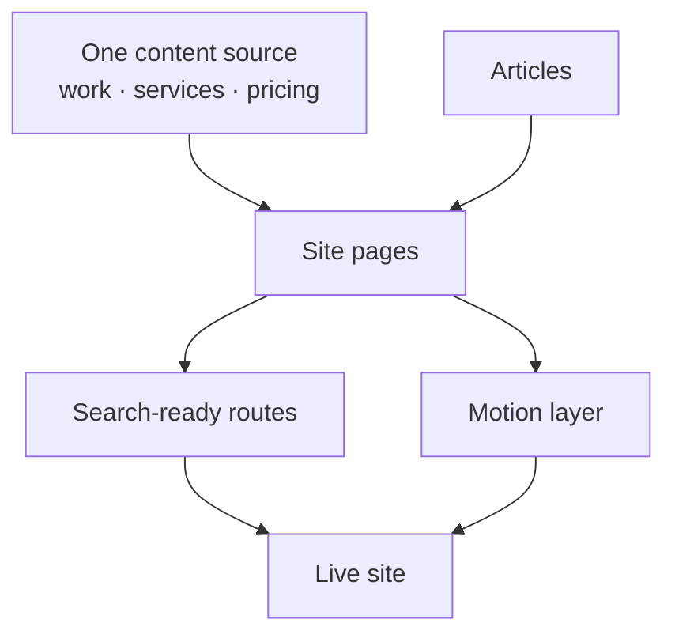

  

<h1 align="center">Higgins Digital</h1>

<strong>The website for Higgins Digital, my software development company: studio, work, services, and a direct path to start a project.</strong>

  &nbsp;
  &nbsp;
  &nbsp;
  

Live · Founded, designed, and built by Davis Higgins · Charlotte, NC

---

## See it in motion

  

Real capture of the live site: menu, Work route transition, and project grid. <a href="assets/demo.png">Static frame</a>

## What it does

- **Shows the work first.** A full-bleed project grid leads to a case study for every build, covering the problem, the direction, what was built, and the specifics.
- **Explains what the company does.** Services, pricing, and a growth offering each get a focused page, plus location pages for the Charlotte market.
- **Makes starting a project easy.** Contact paths, email, and social links are reachable from the menu and the footer on every page.

## Why I built it

Higgins Digital builds websites, platforms, and AI-powered systems for businesses. A company that sells high-end web work has to prove it on its own site first, so this one is held to the same bar as client builds: deliberate typography, motion with a purpose, and accessibility that survives the animation.

It's also the public record of my work, with every case study told one consistent way across the site.

## What I built

I founded Higgins Digital and designed and built its site:

- Information architecture across home, work, case studies, services, pricing, about, contact, blog, and location pages
- A single content source that powers the work grid, every case study, and related links
- Motion: route transitions, a full-screen menu with marquee hover bands, and scroll scenes, all with reduced-motion paths
- Search foundations: sitemap, structured data, per-page metadata, and a blog
- A private client area

<strong>How it's put together</strong>

 

| Decision | Why |
|---|---|
| **One source of truth for the work** | Every project is described once and appears consistently everywhere it's referenced, so case studies can't drift out of sync. |
| **Motion that cleans up after itself** | Animations are scoped to the page they belong to, so moving around the site never leaves anything stuck or sluggish, and every scene has a reduced-motion version. |
| **Accessible under the effects** | Interactive elements are real links and buttons, the menu works fully from the keyboard, and brand colors were tuned until controls met contrast standards. |

## Screens

<table>
  <tr>
    <td width="62%"></td>
    <td rowspan="2" width="38%" align="center"></td>
  </tr>
  <tr>
    <td></td>
  </tr>
</table>

Homepage · Services · Homepage on mobile

## Technology

| Layer | Technology |
|---|---|
| Framework | Next.js, React, TypeScript, Tailwind CSS |
| Motion | GSAP, Lenis, Three.js |
| Hosting | Vercel |

---

  &nbsp;
  

© 2026 Davis Higgins. All rights reserved. The Higgins Digital name and logo belong to Davis Higgins. Project imagery belongs to the respective projects and clients.

