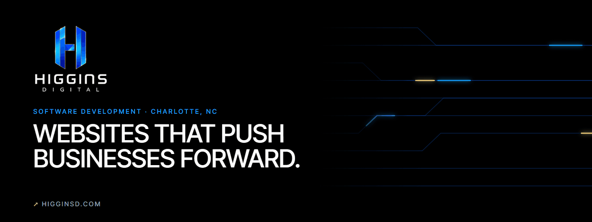
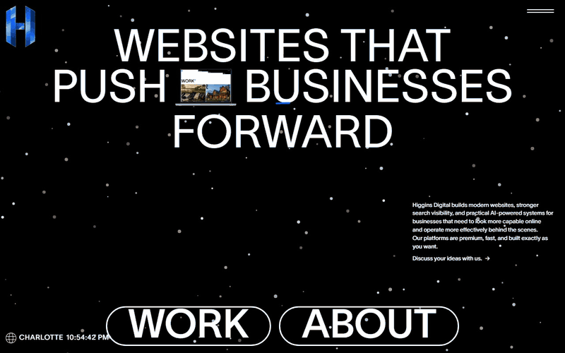
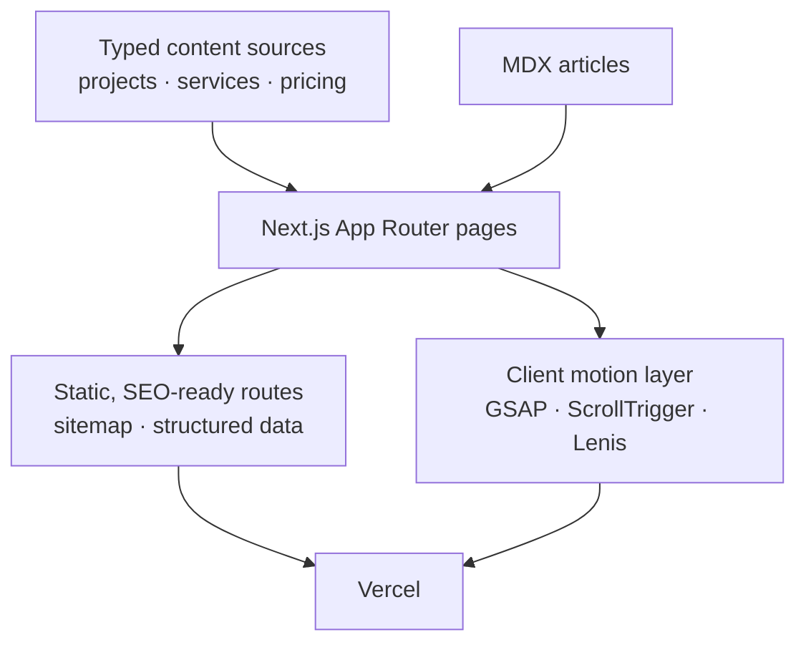
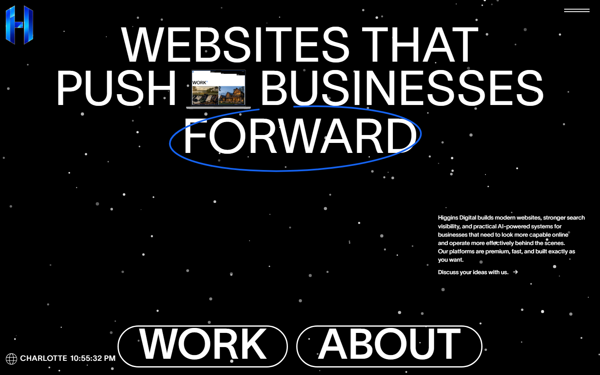
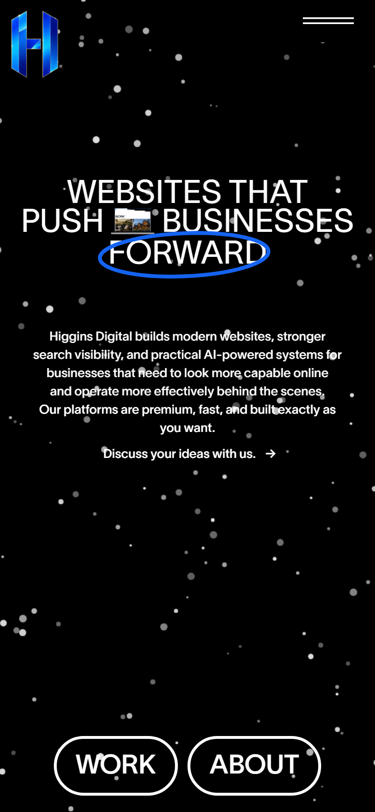
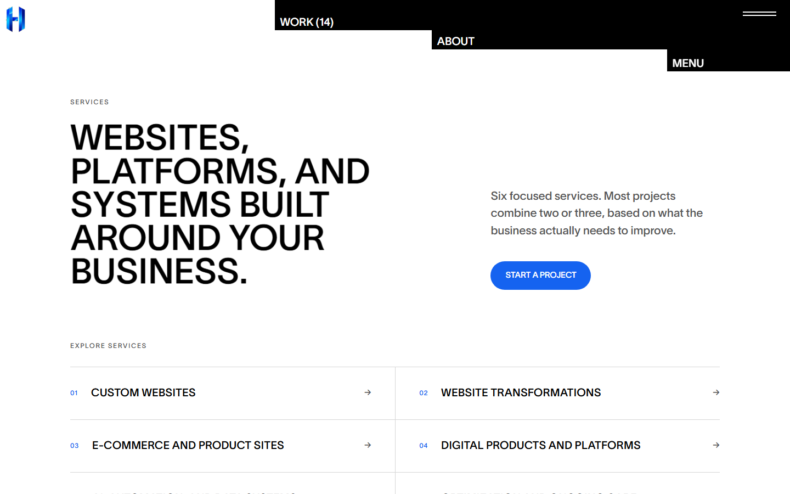

  

<h1 align="center">Higgins Digital</h1>

  <strong>The website for Higgins Digital, my software development company: studio, work, services, and a direct path to start a project.</strong> 
  <a href="https://www.higginsd.com"><strong>Visit higginsd.com ↗</strong></a> · <a href="https://www.higginsd.com/work">Work</a> · <a href="https://www.higginsd.com/services">Services</a> · <a href="https://davishiggins.com">Davis Higgins</a>

Live · Founded, designed, and built by Davis Higgins · Charlotte, NC

---

## See it in motion

  

Real capture of the live site: menu, Work route transition, and project grid. <a href="assets/demo.png">Static frame</a>

## What it does

- **Shows the work first.** A full-bleed project grid leads to a case study for each build. Every study covers the problem, the direction, what was built, and checkable specifics, with client and in-house work labeled honestly.
- **Explains what the company does.** Services, pricing, and a growth offering each get a focused page, plus location pages for the Charlotte market.
- **Makes starting a project easy.** Contact paths, email, and social links are reachable from the menu and the footer on every page.

## Why I built it

Higgins Digital builds websites, platforms, and AI-powered systems for businesses. A company that sells high-end web work has to prove it on its own site first, so this one is held to the same bar as client builds: deliberate typography, motion with a purpose, and accessibility that survives the animation.

It's also the public record of my work. Every case study comes from one typed source, so a project can't be described two different ways on two different pages.

## What I built

I founded Higgins Digital and designed and built its site:

- Information architecture across home, work, case studies, services, pricing, about, contact, blog, and location pages
- A single typed content source that feeds the work grid, every case study, related links, and metadata
- Motion: route transitions, a full-screen menu with marquee hover bands, and scroll scenes, all with reduced-motion paths
- SEO foundations: generated sitemap and robots, structured data, per-page metadata, and an MDX blog
- A private sign-in area that isn't part of this showcase

## How it's put together

### Engineering decisions

| Decision | Why |
|---|---|
| **One source of truth for the work** | Every project lives once in a typed data file that feeds the grid, case studies, related links, and metadata. A test fails the build if a project's images are missing. Outcomes can only appear with a cited source, so there are no invented performance numbers. |
| **Motion is scoped and reversible** | Animations are built with component-scoped GSAP contexts and explicit ScrollTrigger cleanup, so route changes never leave stale listeners behind. Every animated section has a `prefers-reduced-motion` equivalent. |
| **Accessible structure under the effects** | Clickable areas are real links and buttons. The menu traps and restores focus and works from the keyboard. Low-contrast brand colors were adjusted until filled controls cleared WCAG AA. |

## Screens

<table>
  <tr>
    <td width="62%"></td>
    <td rowspan="2" width="38%" align="center"></td>
  </tr>
  <tr>
    <td></td>
  </tr>
</table>

Homepage · Services · Homepage on mobile

## Technology

| Layer | Technology | Responsibility |
|---|---|---|
| Framework | Next.js 15 (App Router), React 19, TypeScript, Tailwind CSS | Pages, routing, metadata |
| Content | Typed data modules, MDX (next-mdx-remote) | Case studies, services, articles |
| Motion | GSAP with ScrollTrigger, Lenis, Three.js | Transitions, menu, scroll scenes |
| Data | Supabase | Private client area and website-audit request intake |
| Quality | Playwright | End-to-end and data-integrity checks |
| Hosting | Vercel | Deployment |

## Credits and notes

- **Design lineage.** Parts of the presentation layer (page composition, GSAP timing values, and navigation and transition structure) derive from the open-source [K72 recreation](https://github.com/AyushAwasthi26/K72) by Ayush Awasthi, under the MIT License. I ported it from Vite and React Router to the Next.js App Router and substantially rewrote it, including reduced-motion handling, semantic controls, and focus management that the original lacked.
- **Typography in this repository.** The live site is set in a commercial typeface. The cover graphic above uses Inter Tight as a free stand-in and doesn't redistribute any font.
- **No invented metrics.** The site and this showcase report scope, not traffic or conversion numbers.

## About this repository

This is a documentation-only showcase. The site's source, client data, and private areas aren't included here.

**[Visit higginsd.com ↗](https://www.higginsd.com)** · Built by [Davis Higgins](https://davishiggins.com) · [More of my work](https://github.com/DavisHiggins)

© 2026 Davis Higgins. Text and images in this repository are shared for portfolio viewing. The Higgins Digital name and logo belong to Davis Higgins. Project imagery shown in screenshots belongs to the respective projects and clients.
